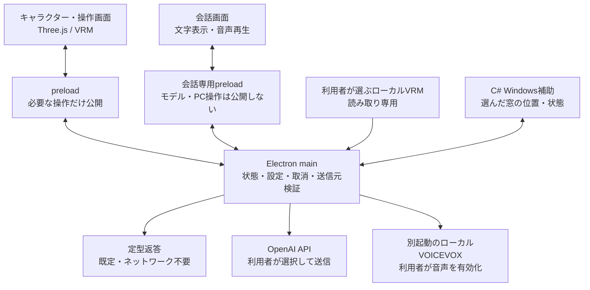

# 技術紹介と開発の担当範囲

shizuku-desktopは、キャラクターが普段のPC作業のそばにいて、呼ぶと短く話せるWindows向けアプリです。機能の多さより、入力を邪魔しない配置、静かな表示、中止・非表示・復帰の確実さを重視しています。このソースは技術試作で、配布用の安定版ではありません。[概要と起動](../README.md)

## 解きたい課題

デスクトップのキャラクターは、表示できるだけでは普段使いしにくくなります。透明な余白がクリックを遮る、移動後に作業中の入力先が変わる、閉じた会話の返答や音声が後から届く、といった問題が作業を中断させます。

そこで「静かに置く→明示的に呼ぶ→短く話す→作業へ戻る」を中心に、停止と復帰も通常操作として設計しました。対象をWindows x64・主画面1枚・手動起動に絞り、万能なPC操作や常時のマイク・画面監視は含めません。

## 構成とデータの境界

画面側はsandbox・context isolationを有効にし、Node.jsと外部ネットワークを使えない設定です。preloadは画面からmainへ必要な操作を渡す橋渡しで、mainは呼出し元と引数を検証します。APIキーを画面へ渡さず、会話はRAM内だけに保持します。閉じる・隠す・接続先変更・休止・終了で履歴と待機を破棄します。外部AIへ送った内容には提供元の保存条件が別に適用されます。

Windows補助は、明示的に選んだ窓の位置・表示状態などを読み、重なり順を調整するのはしずく自身の窓だけです。他アプリのタイトル・内容・入力・画像は取得しません。VOICEVOXは利用者が別に起動し、マイクや外部の音声APIは使いません。[データと停止の詳細](usage.md#安全とデータ)

実装の入口は[main](../src/main.ts)、[描画](../src/avatar.ts)、[会話窓](../src/dialogue-window.ts)、[会話セッション](../src/dialogue-session.mjs)、[Windows補助](../native/WindowTracker.cs)です。

Electronを選んだのは、既存のTypeScript・Three.js／VRMと、透明ウィンドウ・通知領域の操作を接続しやすいためです。Tauriも候補ですが、Rust側の実装とWindowsの挙動を再検証する範囲が増えます。Electronの配布容量と数百MiBのメモリは弱点として測定し、採用したこと自体を軽量性の根拠にはしていません。[技術選択の詳細](usage.md#技術の選択)

## 判断例1：直接ドラッグの問題を隠さず、配置方法を変える

実マウスでキャラクターをドラッグできても、移動前に入力していた別アプリの焦点が外れる問題がありました。ElectronのAPI上で非フォーカスでも、元の入力欄で続けて書けることの証明にはなりませんでした。

通常の配置は、Mキーで開始し、マウスボタンを押さずにポインターを動かし、もう一度Mで確定する方式にしました。移動中もクリック透過を保ち、Escまたは30秒で元へ戻します。他アプリの焦点を強制的に奪い返す処理は加えていません。直接ドラッグは試験中として残します。

このPCの専用入力窓では、実キーのM確定・Esc取消の直後に入力先が残り、続けて文字を入力できた記録があります。ただし、あらゆるアプリや日本語IMEで確認した結果ではなく、直接ドラッグの原因解決とも区別します。[操作と確認範囲](usage.md#呼ぶ動かす隠す終了する)／[検証記録](evaluation.md)

## 判断例2：遅い読み込みより、その後の「隠す」を優先する

モデル選択の結果を保留して「隠す」を押し、その後に選択結果を返すと、アプリがモデルを読み直して再表示する問題を再現しました。読み込みの成功が、後から行った利用者の操作を取り消していました。

選択操作ごとの番号を保持し、「隠す」や休止で古い番号を無効にしました。選択結果・ファイル読み取り・失敗が遅れて届いても、現在の操作に属さなければ使いません。設定の保存待ち中に隠した場合も、保存完了を再表示の理由にしません。

2026-09-13の修正版では、中断・保存待ち・再選択・終了を含む10項目と模擬休止9項目が成功しました。選択結果を自アプリ内で遅らせる検査であり、実ファイル選択窓や実PCのスリープを操作した結果ではありません。[再現・修正・限界](evaluation.md#モデル選択が後から再表示する問題)／[実装](../src/main.ts)

## 本人の判断とAI支援

この個人開発はAI支援を使っています。本人が全コードを独力で記述した、または全挙動を手操作で検証済みという実績にはしません。

| 範囲 | 担当・現在の状態 |
| --- | --- |
| 本人が決めたこと | しずくの体験と性格、UIの方向、作業非干渉・停止と復帰の優先順位、既存アプリとの分離、素材・外部送信・公開範囲の条件 |
| AIが主に支援したこと | 技術候補の整理、実装案、コード・テスト・文書の作成、検査の実行と結果の整理、問題の切り分け |
| 今後本人が確認すること | 実際の作業での入力・IME、実スリープ／ロック、声と間の自然さ、使い続けたいかという評価。説明に使うコードと判断の理解 |

自動検査の成功を本人の実使用評価として記載しません。現時点の確認と残る項目は[検証記録](evaluation.md)と[実使用チェック](user-check.md)に分けています。研究コード・内部資料・参加者情報・私的な録音は持ち込まない方針です。

## 検証をどう読むか

| 検証 | 分かること | それだけでは分からないこと |
| --- | --- | --- |
| `npm run check`・Windows CI | 型、単体ロジック、Windows向けビルド | 描画、実入力、日常の使い心地 |
| Electronの受け入れ検査 | 操作・非同期中断・窓の破棄・保存状態など | 物理クリックやIME、実スリープの挙動 |
| Windows専用窓での実入力記録 | そのPC・対象窓・操作でのクリックや焦点 | 別アプリ・別PC・全操作での成立 |
| 2026-09-13の負荷測定 | 4条件各5分、および別Buildの2時間静止の観測 | 終日・動く表示2時間・実音声合成中の負荷や安定性 |

4条件各5分と2時間静止は、別Build・別条件の過去の測定です。実AIは少数の接続確認、実AI→VOICEVOX→再生→口形は1回の記録で、対話品質の一般評価にはしていません。[測定条件と数値](evaluation.md)／[CIの詳細](ci.md)

未解決・未検証の主な範囲は、直接ドラッグの焦点、メモリ負荷、実IME・実スリープ／ロック、動く表示の長時間使用、別PC、声や動きの自然さです。配布用インストーラー、署名・更新、複数画面、しずく専用の外見も後続です。[完成基準](product-quality.md)

## 3分で見せるローカルデモ

これは実演の手順案です。本人がこの通りに実演済みという記録ではありません。事前に[起動手順](../README.md#起動する)を済ませ、利用条件を確認したVRMを選び、全身が主画面に収まることを確認します。初回ダウンロードとモデル準備は3分に含めません。外部AIは未接続、声はオフで行うためAPIキー・VOICEVOXは不要です。共有する画面は個人情報を含まない確認用の内容にします。

以下のC / M / W / S / R / Qは、すべてCtrl + Alt + Shiftと同時押しです。

| 目安 | 操作 | 説明すること |
| --- | --- | --- |
| 0:00〜0:35 | 空のメモ帳等へ短文を入力し、しずくと透明部分の背後をクリック | 作業を遮らず置けること。実際に入力先が維持されるかを示す |
| 0:35〜1:10 | M→移動→M、再度M→移動→Esc | クリック透過の配置と取消。入力欄をクリックし直す前に続きを書く |
| 1:10〜1:45 | 上に余白を空けた普通の窓を選んでW、窓を動かして戻す | 明示的に選んだ窓への着座・追従 |
| 1:45〜2:25 | Cで呼び、元の欄に入力できるか確認してから会話欄をクリック。「こんにちは」を送って閉じる | 既定は定型返答。呼ぶだけでAI送信しないこと、会話を閉じて常駐へ戻ること |
| 2:25〜3:00 | Sで隠す・戻す、Rで画面端へ戻す、Qで終了 | 困ったときの復帰、終了後に月アイコンが消えてPowerShellへ戻ること |

キーが競合したら通知領域の月アイコンから同じ操作を使います。直接ドラッグはこの基本デモに含めず、未解決の制限として説明します。別の窓へ追従できないなどの失敗は、Rで復帰し、起きた条件を記録します。

## 面接等で説明する前に本人が確かめること

- [実使用チェック](user-check.md)を行い、成功・不具合・未確認を分けて記入する。動作していない操作を台本どおり成功したことにしない。
- 上の2つの判断について、「何が問題だったか」「どこを変えたか」「代替案の弱点」「残る制限」を該当コードと一緒に説明できるようにする。
- 画面・main・Windows補助の役割、キーと会話の扱い、外部へ送る条件を説明する。理解がまだ浅い部分はAI支援で実装した範囲として明示する。
- 数値を使う場合は日付・Build・条件とセットにする。CPU全体比、共有分を含むメモリ、静止と動く表示、模擬休止と実休止を混同しない。
- 表示モデルを自作と紹介しない。動画・画像・音声を公開する場合の素材条件は、ソースのMITとは別に確認する。[第三者通知](../THIRD_PARTY_NOTICES.md)
